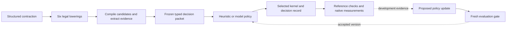

# Harness compiler proof of concept

This project separates a compiler's legal transformations from the policy that chooses among them. It tests a tiny handwritten selector, general model advice, stronger-model escalation and a locally trained policy against measured native outcomes. The public artifacts include unsuccessful experiments as well as useful decisions.

The runnable scheduling example is deliberately narrow: fixed-shape, non-aliasing, unsigned modular matrix contractions on Apple M3. All six loop orders preserve its arithmetic semantics. Python implements the harness and policy boundary; generated C goes through LLVM or Apple Clang. This is a real lowering decision owned by the harness, not a replacement for all downstream compiler heuristics.

## Try a frozen decision anywhere

With Python 3.12 or later, from the repository root:

```sh
python3 -S -m scripts.harness_policy \
  --artifact examples/harness-policy/policy.json \
  --packet examples/harness-policy/packet.json \
  --compiler-identity examples/harness-policy/compiler-identity.json \
  --output /tmp/p4ai-decision.json
diff examples/harness-policy/expected-decision.json /tmp/p4ai-decision.json
```

This prints `ijk` and records scores for all six alternatives. It requires no API key, network, GPU, scikit-learn or compiler installation. It replays an existing feature packet; it does not compile new input. The [example documentation](../examples/harness-policy/README.md) identifies its development case and provenance.

## What makes this a custom harness

The harness supplies a domain contract: a structured operation, exact eligible actions, source and compiler features, a scalar reference, a measurable objective and explicit acceptance gates. A selector supplies one bounded choice. Its output cannot introduce an arbitrary transformation or bypass compilation and output checks.



The frozen forest executes locally using only Python's standard library. It converts features to float32 before tree routing to match scikit-learn semantics, preserves estimator order and breaks ties by canonical action order. It rejects malformed trees, incompatible compiler identities and feature/action schema mismatches. The native caller must obtain compiler identity from the actual binary; a supplied identity file alone does not establish that fact.

## Native rebuild demonstration

On the pinned macOS ARM64 environment, prepare the audit candidates without performance timing, then replay and rebuild one selected kernel:

```sh
uv run --offline python -m scripts.policy_shift_experiment \
  --phase prepare-audit --design experiments/policy-shift-v1.json \
  --output artifacts/policy-shift-reproduction
python3 -S -m scripts.harness_demo \
  --prepared artifacts/policy-shift-reproduction/prepared-audit.json \
  --case-id shift-audit-small-ccr --compiler target \
  --output artifacts/harness-demo-reproduction
```

Use a new output directory for each independent demo. The [recorded result](results/harness-demo-v1.json) selected `ikj`, passed both three-iteration scalar-reference checks, and produced identical object and executable bytes across two fresh rebuilds. This is same-host repeatability, not a hermetic or cross-machine guarantee. The two rebuilds differ from the original prepared executable, while matching its object bytes and code identity. Inspection found different embedded signing identifiers (`selected-kernel` versus `kernel`); executable equality is sensitive to more than the scheduling choice.

The [initial failed demo](results/harness-demo-initial-failure.json) used a one-iteration checksum against a three-iteration reference. The iteration contract was repaired and tested before the successful fresh run. Kernel output itself passed its reference; the wrapper comparison was wrong. The audit's native performance evidence was unchanged.

The present compiler-informed policy compiles every candidate before selection. That is a material cost, not an implementation detail to hide. A future earlier decision boundary would need information available before those compilations, and a new experiment.

## Evidence and limits

| Question | Evidence |
| --- | --- |
| Can a model choose a guarded compiler action? | The native register-allocation pilot executed a live Jev-to-Codex handoff; integration succeeded |
| Does a three-tier cascade improve decisions? | Existing register-allocation and contraction screens did not demonstrate it; several calibrated routes chose never to escalate |
| Does better compiler information help? | The compiler-feedback experiment improved Jev decisions with static compiler evidence; fresh replication retained aggregate gains but failed its group-consistency requirement |
| Does a general model always beat a cheap local model? | No such conclusion: Jev was about 8.5% better in aggregate than one fixed forest in replication, with concentrated regressions |
| Is a local specialist necessarily better? | Not established; grouped development diagnostics show sensitivity to feature representation and training recipes |
| Does moving rules outside the compiler reduce maintenance? | Not established; prompts, features, data, dependencies and validation remain maintained policy |

See the [experiment history](../README.md), [fresh replication](results/feedback-replication-v1.md), [grouped development diagnostic](results/policy-learning-diagnostic-v1.md), and [compiler-shift contract](policy-shift-design.md). Correctness checks cover the defined corpus; they are not a proof for arbitrary C programs.

## Architectural conclusion to test

The strongest current hypothesis is a stable compiler mechanism with versioned policy artifacts and an evidence-driven update workflow. A general adviser can help investigate unfamiliar behavior or prepare an update; its presence in every build must earn its cost. MCP can expose this workflow to agent clients, but it does not itself improve optimization decisions.

The proof of concept is not a claim that learned compiler policies are new. Its research value depends on openly measuring when advice helps, when a small policy suffices, and whether updates actually reduce bespoke maintenance. A negative result at a frozen gate is an outcome, not permission to tune against the test cases until the desired story appears.
