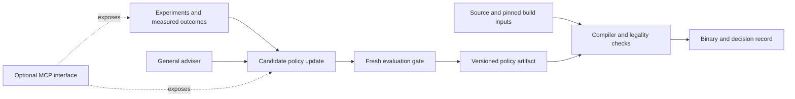

# System One, domain policies, MCP and reproducible compilers

Research synthesis, 18 October 2026. Three independent investigations covered model mechanisms, compiler architecture and the published p4ai evidence. This note separates documented capabilities, measured project results and proposed experiments. No new model was installed, trained or benchmarked for this review.

## The central distinction

A general decision model supplies prior knowledge before we have much domain data. A domain policy turns measured experience into repeatable choices. Neither is automatically better: the choice depends on the information available, the objective, and how frequently the decision contract changes.

Specialize the **decision contract and objective first**. Specialize weights when the measured benefit pays for collecting data, training, deployment and upkeep. Local deployment is a separate decision. A small forest can be hosted; a language model can run locally; either can be embedded behind the same typed interface.

| Question | Alternatives | What it establishes |
| --- | --- | --- |
| What must be understood? | Numeric compiler facts; structured IR; natural-language requirements | The representation the policy needs |
| How is the policy obtained? | Handwritten rule; general pretrained model; domain learning; adapted pretrained model | Where decision knowledge comes from |
| Where does it execute? | Compiler process; local service; hosted service | Deployment, latency and availability properties |
| How is it exposed? | Function; command-line tool; MCP tool | An integration boundary |
| What role does it play? | Per-decision selector; search guide; offline repair adviser | When its costs are incurred |

These axes should not be bundled into a choice between “Jev”, “MCP” and “a compiler”. A compiler can use a learned policy; an MCP server can expose that compiler; Jev can advise the surrounding workflow.

## What System One does and does not buy

TypeSafe documents Jev as shared weights across customers, with domain behavior steered by state, instructions and criteria rather than customer fine-tuning. It also describes using output probabilities as inputs to a downstream model. That makes a useful cold-start hypothesis: semantic prior knowledge may help before we can train an effective specialist. It does not establish compiler expertise or automatic adaptation to a target. [TypeSafe models](https://docs.typesafe.ai/models).

An open typed model does not remove this question. Laya documents supervised fine-tuning and held-out temperature calibration; AnyJev provides a decision readout over a causal language model. Those are implementation options, not evidence that either produces better compiler decisions. Bias correction for option order and well-formed output are distinct from correct action selection. [Laya fine-tuning](https://github.com/NandhaKishorM/laya/blob/main/docs/finetune.md), [AnyJev levels](https://github.com/nokia-applied-research/AnyJev/blob/main/docs/levels.md).

The most promising roles depend on the boundary:

- For unfamiliar text, changing rubrics or loosely described tools, a general semantic model may avoid collecting a new labeled dataset for every change.
- For stable numeric compiler features, a small finite action set and measured performance, a supervised scorer or ranker is a strong baseline. “Custom model” need not mean training a language model.
- For proposing a new transformation or explaining a new failure, selection among existing options is insufficient. A stronger adviser can help generate hypotheses, which still need compiler checks and measurements.
- For recurring decisions already understood through measurements, a general model may become an offline development tool rather than a dependency of every build.

There is also a hybrid: use semantic features from a general model, then train a domain predictor. TypeSafe's own cookbook demonstrates LLM-proposed questions, Jev answers and a CatBoost predictor on wine-review labels. This is an architectural example, not compiler evidence. If those features still require Jev at inference time, the deployed policy still depends on Jev; adding a local prediction head has not eliminated that cost. [Feature-discovery cookbook](https://docs.typesafe.ai/cookbooks/autoresearch_feature_discovery).

## Compiler precedent and the real maintenance question

LLVM MLGO already separates correctness-preserving decisions from optimization decisions, and supports learned inlining and register-allocation heuristics. Its training infrastructure is separate from LLVM's inference integration. Thus a learned heuristic can be part of an ordinary compiler distribution; a network service is not an architectural requirement. [LLVM MLGO](https://llvm.org/docs/MLGO.html).

TVM's MetaSchedule combines a search space, candidate measurement, a database and replaceable cost models, including XGBoost, MLP and random baselines. This is useful precedent for treating the predictor as one component of a measured optimization system. [MetaSchedule tutorial](https://tvm.apache.org/docs/deep_dive/tensor_ir/tutorials/meta_schedule.html), [API](https://tvm.apache.org/docs/reference/api/python/meta_schedule.html).

Our architectural recommendation is to retain the compiler's semantics, legality machinery and implementation of transformations. Replace an expensive-to-maintain selection heuristic only where evidence supports that replacement. Hard resource limits belong in authoritative checks. Performance preferences belong in the objective. Historical regularities can be learned.

Moving the same handwritten conditions into prompts, a rule DSL or an MCP server does not reduce policy maintenance. It may improve editing or observability, but the conditions still have to be understood, updated and tested. Conversely, replacing rules with a model shifts work into features, labels, corpus coverage, compatibility and regression testing. Count that work before claiming a simpler system.

A direct compiler patch remains a serious competitor. If one small heuristic fixes a stable problem, it may be the best engineering result. A learned policy becomes compelling when a generic update procedure repeatedly adapts to new conditions with less bespoke work at acceptable quality and cost. That is the hypothesis p4ai needs to test.

## Where MCP fits

MCP standardizes how an AI application connects to external tools and data. It does not itself choose an optimization, learn a cost model or establish that an action is correct. [MCP introduction](https://modelcontextprotocol.io/docs/getting-started/intro).

For p4ai, an eventual MCP interface could expose operations such as inspecting a decision, evaluating a bounded candidate set, retrieving an evidence bundle and preparing a policy update. Jev, Codex or a human could use the same underlying capabilities. These are proposed operations, not an implemented server.

Keep the core as a library/CLI with explicit inputs and outputs first. Add an MCP adapter when multiple agent clients need it. A remote call per compiler decision would add serialization, availability and latency concerns without inherently improving selection. A service can be justified for expensive shared search or distributed measurement; that is a separate workload decision. Neither local nor remote MCP implies a particular intelligence level.

The promising separation is between an exploratory workflow and a pinned build workflow:

This allows substantial intelligence in preparing an update without requiring an autonomous agent to reconsider every release build.

## Reproducibility is compatible with learned selection

The reproducible-build definition concerns recreating identical artifacts from the same source, build environment and instructions. It does not require every optimization rule to be handwritten. [Reproducible Builds definition](https://reproducible-builds.org/docs/definition/).

Our proposed build contract would pin the compiler, policy artifact, feature schema, target configuration, flags and any profiles or selected optimization plan. Inference must have stable action ordering and tie-breaking, and its numerical implementation must be tested for the supported environment. Frozen weights alone do not prove deterministic decisions; deterministic decisions alone do not prove byte-identical binaries, since the rest of the build can introduce variation.

An alternative is to run exploratory search once and record its accepted decisions in a versioned plan. Later builds replay that plan against matching source/IR and toolchain identities, reject mismatches and use a declared fallback. This is analogous in purpose to treating a profile as an explicit build input. It is a proposal, not current p4ai functionality.

A live provider alias or fresh timing-based search during every release build would complicate reproducibility. A pinned, locally executable policy or checked replay plan is the stronger design here. Reproducibility means reproducing a selected configuration; it does not mean future policy versions must produce the same binary as earlier versions.

## Escalation should buy expected improvement

Jev's documented Choice confidence rescales the largest option probability relative to the uniform distribution: `(p_max - 1/n) / (1 - 1/n)`. This measures concentration of the returned distribution. It is not, by itself, an empirically validated probability that the compiler choice is optimal, nor the expected benefit of calling another model. [TypeSafe confidence](https://docs.typesafe.ai/confidence).

For compiler decisions, near-equal alternatives can make uncertainty harmless. A confident mistake can be expensive. A useful escalation policy must estimate whether a particular next step reduces decision loss enough to repay its cost. That next step might be measuring another candidate, extracting a missing compiler fact, consulting a stronger adviser or using a conservative default.

For example, compare estimated execution time saved over the binary's expected use with added compilation/search time, keeping the units explicit. If execution frequency is unknown, report a break-even usage count rather than inventing it. Token cost is only one component. Feature extraction, measurement, serving and policy validation also count.

Distillation is optional. Train directly on measured outcomes as the control; compare adviser-assisted labels, features or repair against it. Imitating a teacher can transfer its mistakes, while exact action measurements can provide better targets. Our present six-action problem permits measuring all actions on selected workloads. More sequential compiler decisions may require a different learning setup because early choices alter later states.

## What p4ai actually establishes

The [initial compiler-feedback study](../results/compiler-feedback-v1.md) and [fresh replication](../results/feedback-replication-v1.md) support a limited but useful conclusion: a general informed adviser can sometimes improve this compiler decision. They do not establish lower maintenance, a universal escalation ladder or broad target generalization.

The replication's training data has 36 workload cases and six actions per case. Its 216 action rows are **not 216 independent programs**. The cases come from nine dimension/padding recipes, with four layout variants each. The old test cases were incorporated into replication training and must no longer be described as untouched test data.

The replication evaluated 24 fresh cases from six new recipes, with three Jev choices per case and two timing blocks. Exact recipes were disjoint; four of six broad shape names and all eight layout signatures recur. The kernel and action family are unchanged. This tests new recipes within a narrow family, not new compiler families or hardware targets.

Jev's group-balanced runtime was approximately 8.5% lower than the fixed forest in both blocks. It nevertheless failed the frozen consistency gate: only three of six groups improved against the forest, where four were required. The aggregate gains exceeded the declared noise thresholds; the group gate tests direction, not a separate noise threshold for each group. The wide group was about 13.3% worse. The agent audit also found that Jev and forest differed on only six of 24 cases. This is evidence of both useful decisions and concentrated failures, not a reason to dismiss either model class.

The policy input has 30 source features and 12 compiler-derived features. Compiler-derived inputs incur compilation before selection; their cost cannot be attributed solely to model inference. Forest fitting was about 0.21 seconds in the recorded run, but cheap fitting is not evidence of adequate generalization or low total maintenance.

Possible explanations for the residual gap include scarce independent recipes, missing features, model-family limitations and heterogeneous workload behavior. The experiment does not distinguish these. All inspected replication cases are now development evidence. Fresh evaluation is necessary for the next claim.

## The next falsifiable investigation

First use existing development data for recipe-grouped learning curves and representation ablations. Keep every layout and action from a recipe in the same fold. Compare 30 source features with 42 compiler-informed features, and small predictor families, with tuning confined to inner folds. This diagnoses whether more representative data or better features are likely to matter before adopting another language-model stack. Small sample sizes must remain visible.

Then freeze a compiler-shift repair trial on the available CPU: the pinned LLVM build versus Apple Clang, with the same workload semantics and legal actions. This is a toolchain change, not a claim that one version is an upgrade of the other.

1. Establish repeatable regret against each toolchain's own measured best actions. Stop if there is no meaningful repair opportunity.
2. Compare an unchanged policy, a direct heuristic patch and a generic learned-policy refit using the same adaptation evidence and declared budgets.
3. If testing adviser-assisted repair, give the direct-patch arm equal access to adviser assistance. Otherwise assistance and architecture are confounded. Record all attempts, not only the accepted update.
4. Freeze the resulting policies before evaluating fresh recipe groups. Include broader structural coverage where the action contract remains valid; do not label this arbitrary-program generalization.
5. Report quality, correctness checks, regression tails, build/search/inference cost, label acquisition, dependencies and bespoke edits. Repeat independent update tasks before claiming reduced human maintenance.

MCP is not needed to establish this result. An open language-based specialist is warranted only if a residual need for semantic representation survives the simpler controls. A three-tier runtime cascade is warranted only if its interventions improve measured utility. The reusable platform contribution would be the decision contract, evidence collection, update procedure and reproducible policy deployment—not an obligation to keep every model in every build.
